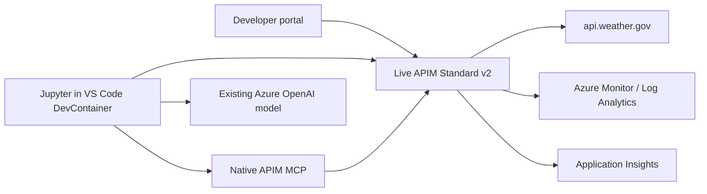

# APIM: protect, publish, observe, and expose weather tools

A presenter-led, **55-minute Azure API Management walkthrough**, with a
5-minute discussion buffer. Provisioning is **not** part of the presentation.
Every module can be skipped or run independently from the seeded baseline.

| Start here | Purpose |
| --- | --- |
| [Setup](docs/setup.md) | DevContainer, CFS, deployment, and presenter preflight |
| [Runbook](docs/runbook.md) | Fixed presentation budgets and skip points |
| [Module instructions](docs/modules.md) | Click-by-click portal and notebook walkthrough |
| [Notebook](notebooks/walkthrough.ipynb) | Human-run protection, monitoring, MCP, and AI examples |
| [Architecture and boundaries](docs/architecture.md) | Resources, policy scopes, tags, and security limitations |
| [Troubleshooting and cleanup](docs/troubleshooting.md) | Explicit failures, resets, and teardown |
| [Specification](specs/001-apim-walkthrough/spec.md) | Reviewed Spec Kit development scope |

Includes the **complete Weather.gov REST API: 69 snapshot operations**,
a deliberately synthetic security lab, products and subscriptions, developer
signup, policy authoring, policy fragments, API tags, monitoring, native MCP,
and one small model-driven tool call.

All tools are installed **inside the local DevContainer**, using CFS for package
dependencies. APIM runs only in Azure. Infrastructure is Bicep; `azd up` seeds
the baseline and publishes the managed developer portal. There is no deployed
application container, custom MCP server, database, or hosted agent.

**This is a temporary learning environment, not a production security design.**
APIM protects its own endpoint; it cannot prevent direct use of the already-public
Weather.gov API. No live Azure deployment is performed by opening this project.
