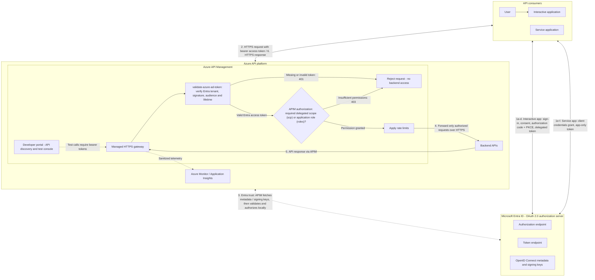

# Architecture, policy scopes, and boundaries

## Traditional Azure API Management with OAuth 2.0

This reference architecture shows a conventional managed APIM gateway protecting
backend APIs with Microsoft Entra ID. It is conceptual, not the configuration
deployed by this demo: the demo uses subscription keys and does not provision
OAuth application registrations, token-validation policies, or private backends.

**APIM authorizes API access using Entra-issued access tokens.** Entra ID
authenticates the caller and issues tokens containing granted permissions; APIM
is the enforcement point that validates those tokens and checks their permissions
before allowing a request to reach the backend. This does not require an online
authorization call to Entra ID for each API request.

- **Delegated access:** the interactive application uses authorization code with
  PKCE; user sign-in and consent occur at Entra ID. Confidential clients also
  authenticate when exchanging the code.
- **App-only access:** a service authenticates directly to the token endpoint
  using client credentials; no user sign-in is involved. Keep credentials out of
  browser applications.
- **Entra configuration:** register the protected API and its clients in Entra
  ID. Expose delegated scopes for interactive callers and application roles for
  service callers; configure the corresponding grants, assignments, and consent.
  Clients request access tokens for this API, not Microsoft Graph or the APIM
  management API.
- **Gateway enforcement:** configure `validate-azure-ad-token` in APIM's inbound
  pipeline for the intended tenant and API audience. Check the required delegated
  scopes (`scp`) or application roles (`roles`) for the requested operation.
  `required-claims` can enforce permissions within the validation policy;
  alternatively, use policy expressions and `choose` / `return-response` after
  validation for separate authorization decisions. For the diagram's split
  behavior, return 401 for a missing or invalid token and 403 for a valid token
  lacking permissions. Claim failures inside the validation policy instead use
  its configured failure status (401 by default). APIM validates tokens locally
  using cached signing keys, not by calling Entra ID for every API request.
- **Backend boundary:** restrict backend ingress to the gateway where possible.
  Configure backend authentication separately, for example APIM managed identity
  or mutual TLS; caller-token forwarding is appropriate only when the backend
  accepts that token's audience. Subscription keys, if required, are additional
  product access controls, not a replacement for OAuth authorization.
- **Portal boundary:** configuring OAuth in the developer portal enables token
  acquisition for its test console; it does not enforce authentication on the
  gateway. Token-validation and authorization policies must be configured.

Microsoft documentation:
[Protect an API using OAuth 2.0 and Microsoft Entra ID](https://learn.microsoft.com/en-us/azure/api-management/api-management-howto-protect-backend-with-aad)
and
[`validate-azure-ad-token` policy reference](https://learn.microsoft.com/en-us/azure/api-management/validate-azure-ad-token-policy).

## Resource inventory

- A resource group named from the AZD environment.
- One-unit APIM **StandardV2**, public HTTPS gateway and managed developer portal.
- Log Analytics plus workspace-based Application Insights.
- APIM system identity with Monitoring Metrics Publisher scoped to Application
  Insights; no custom identity application registration.
- Complete `weather` API from the checked-in snapshot, with fixed Weather.gov
  backend and identifying User-Agent.
- Isolated `security-lab` API with a synthetic `GET /probe` response.
- Native `weather-mcp` API and three selected tool resources.
- Published `weather-demo` product, existing built-in developer/guest visibility,
  seeded developer, and active product-scoped presenter subscription.
- Policies, reusable fragments, API tags, logger, and diagnostic settings.

The existing Azure OpenAI model is a client-side configuration input. It is not
imported into resource ownership, retagged, redeployed, or removed by this demo.

## Tagging

All taggable created resources carry **SecurityControl=Ignore**, plus demo
purpose/AZD environment tags. The spelling is the corrected value confirmed by
the user. This does not disable corporate Azure policies or security controls.

APIM APIs, operations, tools, products, users, subscriptions, policies, fragments,
API-tag relationships, loggers, diagnostics, and portal revisions do not expose
Azure resource tags in their resource contracts. Role assignments and diagnostic
settings also do not accept those tags. Do not invent unsupported `tags`
properties or claim resource-group tags are automatically inherited.

**APIM API tags** (`Weather`, `Public data`, `Security lab`, `MCP`) are separate
API discovery/governance entities and are seeded explicitly.

## Policy composition

| Scope | Policy |
| --- | --- |
| Global | Exact developer-portal origin CORS; normal forwarding/inheritance |
| Weather API | Include weather-backend: fixed HTTPS upstream, User-Agent, strip gateway credentials |
| Lab API | Include lab-protection, then lab-response; no upstream call |
| MCP API | Explicit subscription requirement and independent rate-limit namespace |

The presentation changes only a lab fragment/reference. `return-response`
terminates the pipeline, so its visible response header is defined inside the
response itself. Every consuming API explicitly includes `<base />`.

The full upstream OpenAPI 3.1.2 snapshot is preserved in
[weather.openapi.json](../api/weather.openapi.json). Bicep imports a generated
[OpenAPI 3.0.3 copy](../api/weather.apim.openapi.json), because APIM rejects the
snapshot's 3.1 nullable type arrays. The conversion changes the OpenAPI version
and replaces each `[type, "null"]` with a scalar `type` and `nullable: true`;
four null-only composition branches become nullable strings constrained by
`enum: [null]`, preserving their null-only meaning. Paths, operations, parameters,
existing enums, and other schema fields remain unchanged. Schema-level 3.1
`examples` arrays become a 3.0 `example` using the first entry; the complete array
is retained as `x-original-examples`. Example data itself is never rewritten.
Both documents are validated and minified to fit Bicep's
`loadTextContent` limit. Hashes and every conversion are recorded in
[inventory.json](../api/inventory.json). Unsupported additional 3.1 constructs
fail validation rather than being silently removed. The inventory and
representative live calls remain acceptance gates; schema validation alone is
not proof that APIM imported or enforces the full contract.

The imported operation IDs retain the snapshot's spelling and case, including
underscores. The MCP tools bind to `point`, `gridpoint_forecast`, and
`alerts_active_area`; do not replace underscores with hyphens. Inventory
verification checks each operation ID together with its HTTP method and path.

## Security boundaries

- Scoped subscription keys are intentionally simple. They are bearer secrets,
  not individual identity, OAuth consent, or a production authorization system.
- CORS allows the portal's browser console; it is not access control.
- APIM cannot block direct use of the public upstream. No claim of backend
  network isolation is made.
- Keys are passed in headers, never printed, and stripped before Weather.gov.
  Notebook outputs must be cleared before sharing.
- Logging allows safe demo headers only, disables body logging, and preserves
  streamable MCP responses. Diagnostic log requests do not forward secrets to AI.
- Public upstream/model output is untrusted; tool names/arguments are checked
  and model execution is bounded.
- No WAF, Defender rollout, custom domain, private networking, complex JWT flow,
  or production hardening is included.

## Development and lifecycle

All local execution is inside the DevContainer. CFS supplies packages only at
local build/development time. Bicep defines infrastructure/configuration.
The AZD postprovision hook performs operational checks, first-account prompting, portal
publication, and bounded real telemetry warm-up.

Credentials for the seeded account are passed through an owner-only temporary
parameter file, deleted after the deployment command. Passwords are secure Bicep
parameters. Existing account/subscription resources are not recreated on seed
reruns. AZD outputs contain no keys/passwords.

The notebook uses the presenter's container-local Azure CLI login for management
and model inference. Do not mount host credential directories or include tokens
in the image. Resource creation and cleanup are explicit human actions.
